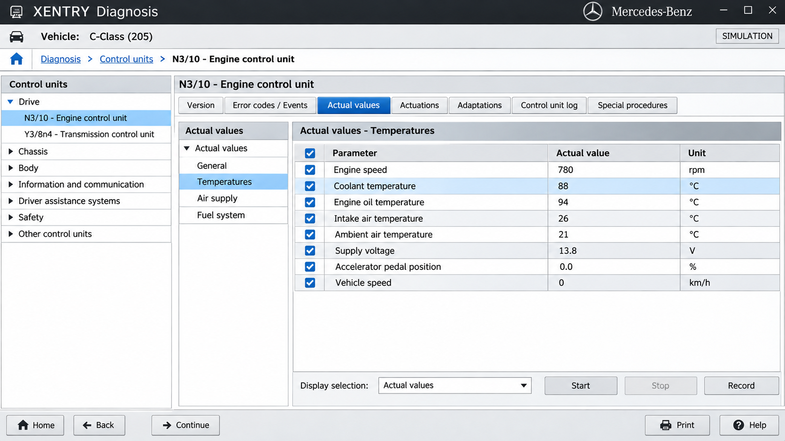
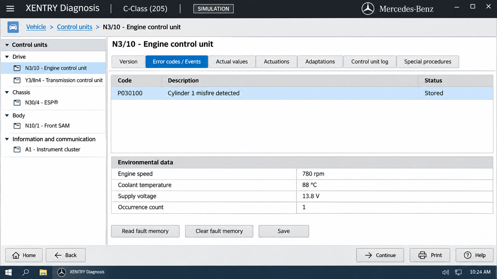
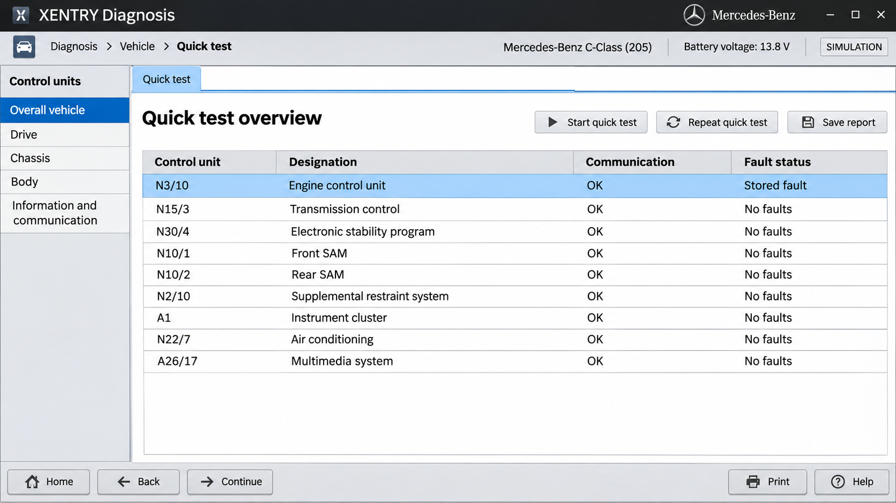

# Xentry Vehicle Diagnostics - Open Source Vehicle Diagnostic Workbench

Xentry Vehicle Diagnostics is a Rust-based vehicle ECU diagnostic workbench maintained by Xentry Diagnosis. It provides CAN tracing, OBD-II functions, automated UDS and KWP2000 scanning, diagnostic sessions, fault-code handling, and communication through J2534 PassThru or SocketCAN.

## Features (Current)

[](https://xentry-diagnosis.github.io/xentry-vehicle-diagnostics/xentry-diagnosis)

- CAN tracer for monitoring vehicle traffic.
- OBD toolbox covering services 01 through 10.
- Automated UDS and KWP2000 diagnostic scanning.
- ECU identification and VIN reading.
- Diagnostic session control.
- Stored diagnostic trouble code reading and clearing.
- Manual, JSON, KWP2000, and UDS diagnostic sessions.
- SAE J2534 PassThru and Linux SocketCAN communication.
- Reusable diagnostic schemas shared across Xentry Vehicle Diagnostics components.

### What is a Mercedes-Benz Xentry?

Mercedes-Benz XENTRY is the manufacturer diagnostic environment used for supported Mercedes-Benz cars, vans, and commercial vehicles. Depending on the licensed product and vehicle, it may provide guided troubleshooting, control-unit diagnosis, coding, programming, workshop information, and authenticated online functions.

Xentry Vehicle Diagnostics is different. The repository offers inspectable implementations of OBD2, UDS, KWP2000, CAN, SocketCAN, and J2534 communication for development and lawful testing.

## Screenshots



Xentry Vehicle Diagnostics presents scanning, manual diagnosis, OBD data, logs, and CAN traffic through dedicated windows implemented under [`app_rust/src/windows`](app_rust/src/windows/mod.rs).

## Diagnostic Adapter API Support

- SAE J2534 PassThru through the [PassThru API](app_rust/src/commapi/passthru_api.rs).
- SocketCAN on Linux through the [SocketCAN API](app_rust/src/commapi/socket_can_api.rs).
- PDU communication through the [PDU API](app_rust/src/commapi/pdu_api.rs).
- Shared interface selection through the [communication interface](app_rust/src/commapi/iface.rs).

Xentry compatible diagnostic interfaces depend on the operating system, installed drivers, protocol support, and vehicle. Xentry OpenPort or OpenPort 2.0 Xentry searches commonly refer to J2534 hardware, but compatibility must be verified with the adapter manufacturer. Xentry C4, Xentry C5, Xentry C6, MB Star C6, and Xentry Diagnosis Pad 2 hardware are not bundled with this repository.

## Platform Support

| OS | Adapter support | Note |
|---|---|---|
| Windows | J2534 PassThru | Requires a compatible vendor driver. |
| Linux | SocketCAN | Interface configuration and vehicle-safe hardware are required. |
| Linux | J2534-compatible implementations | Support depends on the driver and adapter. |

Windows and Linux builds are represented by the [Windows workflow](.github/workflows/app-windows-i686-msvc.yml) and [Linux workflow](.github/workflows/app-linux.yml).

### What is the best OBD software for Mercedes-Benz?

The best choice depends on the task. Official Mercedes-Benz XENTRY is generally the appropriate option for supported factory procedures, authenticated online work, guided diagnostics, and operations requiring manufacturer authorization. Its supported functions depend on the purchased product, account permissions, region, vehicle, and diagnostic interface.

Xentry Vehicle Diagnostics is more appropriate when developers need an open codebase for CAN tracing, OBD2 inspection, UDS or KWP2000 research, and J2534 experiments. Generic OBD software can read standardized emissions data, but it cannot automatically reproduce Mercedes Star Xentry coverage, Xentry guided diagnostics, Xentry ECU coding, or Xentry ECU programming. Programming and coding can damage a control unit or vehicle when procedures, power supply, security access, or data are incorrect.

### How much does a Mercedes Xentry cost?

There is no single universal Xentry price. Official Xentry diagnostic software price and Xentry subscription cost vary by region, package, subscription period, diagnostic hardware, supported vehicle category, and access to online services. Xentry Diagnosis Pad 2 price and interface costs may also be separate from software licensing.

Consult an authorized Mercedes-Benz channel for current official pricing and eligibility. Avoid assuming that unofficial marketplace bundles provide valid licenses, current data, secure online access, or supported hardware.

## Xentry Vehicle Diagnostics ECU Schema

Xentry Diagnosis uses shared schema types to represent diagnostic services, variants, and trouble codes:

- [`common/src/schema/diag/dtc.rs`](common/src/schema/diag/dtc.rs) defines diagnostic trouble-code data.
- [`common/src/schema/diag/service.rs`](common/src/schema/diag/service.rs) defines diagnostic service data.
- [`common/src/schema/variant.rs`](common/src/schema/variant.rs) represents ECU variants.
- [`common/src/raf.rs`](common/src/raf.rs) provides random-access file support.
- [`common/src/lib.rs`](common/src/lib.rs) exposes the common library.

## Repository Structure

### app_rust

The main Xentry Vehicle Diagnostics application is configured by [`app_rust/Cargo.toml`](app_rust/Cargo.toml). Its communication APIs, diagnostic protocols, themes, widgets, and windows are implemented below `app_rust/src`.

### common

The shared Rust library is configured by [`common/Cargo.toml`](common/Cargo.toml). It contains reusable file-access and diagnostic-schema components for Xentry Diagnosis.

## Diagnostic Vocabulary

xentry diagnosis, xentry mercedes, mercedes benz xentry, xentry software, xentry passthru, xentry vehicle diagnostics, mercedes-benz, automotive-diagnostics, vehicle-diagnostics, obd2, ecu-programming, j2534, can-bus, diagnostic-software

## Usage

Build and run Xentry Vehicle Diagnostics from the repository root:

```shell
cargo run --manifest-path app_rust/Cargo.toml
```

Use the launcher to choose an available communication interface, then select OBD, scanning, manual diagnosis, or a protocol-specific session. Confirm the vehicle, ECU, bus, adapter, and voltage requirements before transmitting commands.

### Launch Args

- `-debug_ui` enables user-interface boundary and layout diagnostics.

## Notes

Xentry Vehicle Diagnostics separates communication, protocol, schema, and user-interface responsibilities:

```text
Application Windows
        |
Diagnostic Sessions
        |
UDS / KWP2000 / OBD2
        |
J2534 / PDU / SocketCAN
        |
Diagnostic Interface
```

The [communication API](app_rust/src/commapi/comm_api.rs) coordinates adapter access. Protocol implementations process application-layer requests and responses, while windows such as the [diagnostic scanner](app_rust/src/windows/diag_scanner.rs), [manual diagnosis view](app_rust/src/windows/diag_manual.rs), and [CAN tracer](app_rust/src/windows/cantracer.rs) expose those operations to users.



## Basic Usage

Open the [diagnostic home](app_rust/src/windows/diag_home.rs), select an interface, and establish communication only after verifying the connection settings. Use the [OBD window](app_rust/src/windows/obd.rs) for standardized services or the [diagnostic scanner](app_rust/src/windows/diag_scanner.rs) to discover supported diagnostic behavior.

The [UDS session](app_rust/src/windows/diag_session/uds_session.rs) and [KWP2000 session](app_rust/src/windows/diag_session/kwp2000_session.rs) provide protocol-specific workflows. The [log view](app_rust/src/windows/diag_session/log_view.rs) helps inspect requests, responses, and failures.

## Commands

Xentry Vehicle Diagnostics implements the standard OBD service modules listed below:

- Service 01 reads current powertrain data.
- Service 02 reads freeze-frame data.
- Service 03 reads stored diagnostic trouble codes.
- Service 04 clears emissions-related diagnostic information.
- Services 05 and 06 access supported monitoring results.
- Service 07 reads pending diagnostic trouble codes.
- Service 08 requests supported control operations.
- Service 09 reads vehicle information such as the VIN.
- Service 10 reads permanent diagnostic trouble codes.

The implementation begins in [`app_rust/src/commapi/protocols/obd2/mod.rs`](app_rust/src/commapi/protocols/obd2/mod.rs), while diagnostic code definitions are stored in [`app_rust/src/commapi/protocols/obd2/codes.rs`](app_rust/src/commapi/protocols/obd2/codes.rs).

## Common Issues

J2534 is primarily associated with Windows vendor drivers, while SocketCAN is native to Linux. A recognized adapter does not guarantee support for every bus, protocol, control unit, or Xentry Passthru setup. Incorrect bit rates, addressing, drivers, permissions, or wiring can prevent communication.

Xentry J2534 setup should begin with the adapter vendor’s driver and documentation. Xentry diagnostic system requirements also depend on the selected interface and build target. Keep the vehicle on a stable power supply and avoid write operations until the exact ECU procedure is understood.

### Where can I get Xentry?

Official Mercedes-Benz XENTRY products should be obtained through authorized Mercedes-Benz sales, service, or regional XENTRY channels. Availability, Xentry online access, Xentry Portal access, supported vehicles, subscriptions, and hardware vary by region and customer eligibility. An official source is the appropriate place to ask where to buy Xentry Diagnosis.

Xentry Vehicle Diagnostics is obtained through the single release button above. Be cautious with unofficial copies advertised as official Xentry software, especially when they request disabled security controls or provide unknown modified system images.

## DBC File Basics

A DBC file describes how CAN messages and signals are encoded. A vehicle can contain multiple CAN buses, and each bus can require different message definitions.

Xentry Vehicle Diagnostics includes CAN tracing. Record observations carefully, compare repeated behavior, preserve units, and leave uncertain bits undefined rather than assigning unsupported meanings.

## How to Start Reverse Engineering Cars

Begin with passive observation on a controlled vehicle or bench setup. Record normal traffic, identify message timing, and change one observable condition at a time. Never send guessed commands to steering, braking, restraint, powertrain, or security systems.

Use Xentry Vehicle Diagnostics CAN tracing for inspection and its protocol sessions only when the addresses and services are known. Standard OBD2 data is not equivalent to manufacturer-specific Xentry fault code diagnosis or Xentry commercial vehicle diagnostics.

## Testing

The Rust test entry point is [`app_rust/src/cli_tests/mod.rs`](app_rust/src/cli_tests/mod.rs). Run the available package tests with:

```shell
cargo test --manifest-path app_rust/Cargo.toml
```

Hardware-dependent checks require a compatible adapter or a controlled test environment. Separate protocol tests from live-vehicle tests, and do not treat a successful simulated response as proof that a command is safe for a physical ECU.

## Safety Model

Xentry Vehicle Diagnostics can communicate with safety-relevant control units. Read-only inspection is lower risk than clearing codes, resetting ECUs, changing sessions, coding, programming, or sending custom requests, but even diagnostic traffic can affect vehicle behavior.



Use an isolated bench setup whenever possible. Do not perform Xentry ECU programming or Xentry ECU coding without correct data, recovery procedures, authorization, stable voltage, and an exact understanding of the target ECU.

## Code Rigor

The repository provides automated build definitions in [`app-linux.yml`](.github/workflows/app-linux.yml), [`app-windows-i686-msvc.yml`](.github/workflows/app-windows-i686-msvc.yml), and [`build.yml`](.github/workflows/build.yml). Protocol implementations are separated by service and transport so that changes can be reviewed narrowly.

Contributors should preserve protocol boundaries, validate message lengths, handle malformed responses, and avoid unsafe defaults. New diagnostic operations should include tests and clear failure behavior.

## Standards

Xentry Vehicle Diagnostics is organized around established vehicle-diagnostic concepts:

- SAE J2534 PassThru for diagnostic interface access.
- ISO 14229 Unified Diagnostic Services.
- ISO 14230 Keyword Protocol 2000.
- ISO 15765 transport over CAN.
- SAE J1979 and related OBD-II service behavior.
- SocketCAN for Linux CAN communication.

Implementation coverage is defined by the repository code and should not be inferred from the complete scope of any standard.

## Contributions

Contributions to Xentry Diagnosis and Xentry Vehicle Diagnostics should be focused, testable, and safe. Read [`CONTRIBUTING.md`](CONTRIBUTING.md) before proposing protocol, interface, schema, or user-interface changes.

Report the adapter, operating system, vehicle or bench ECU, protocol, addressing mode, request, response, and reproducible steps when describing a diagnostic issue. Remove VINs, credentials, customer data, and security-sensitive material before sharing logs.

## License

See [`LICENSE`](LICENSE).
